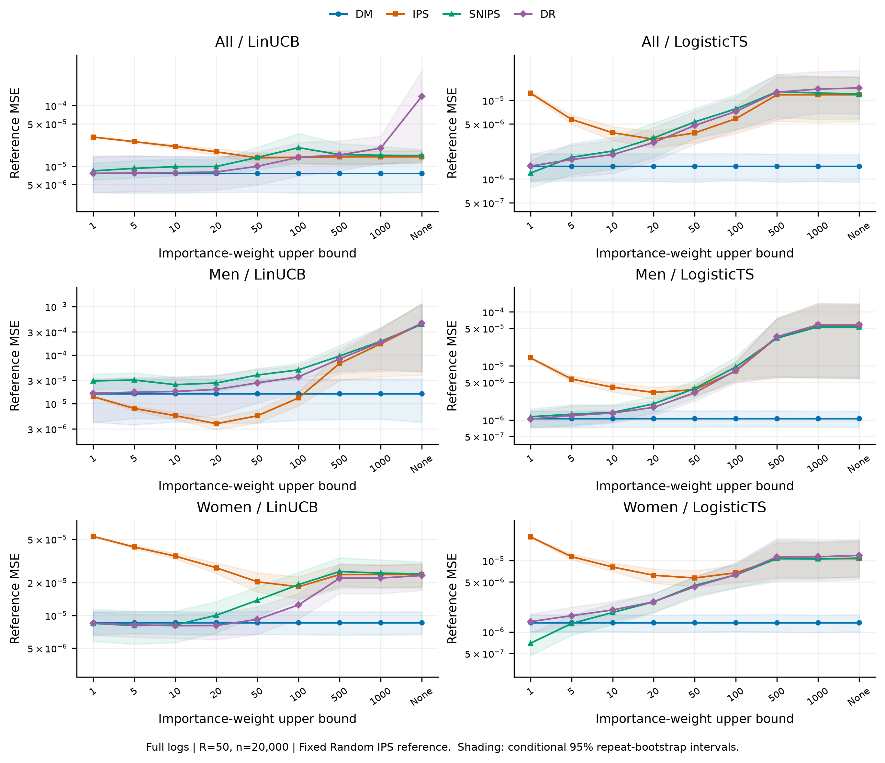
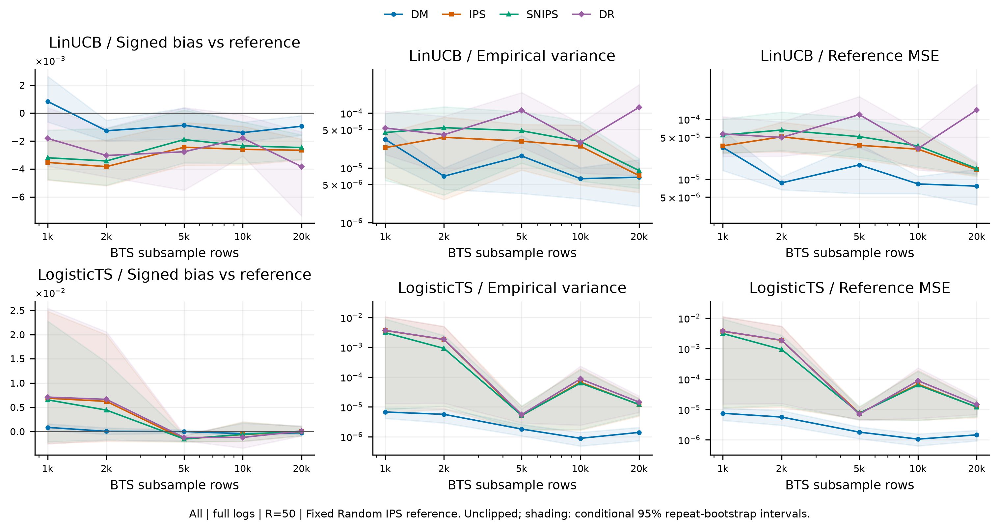
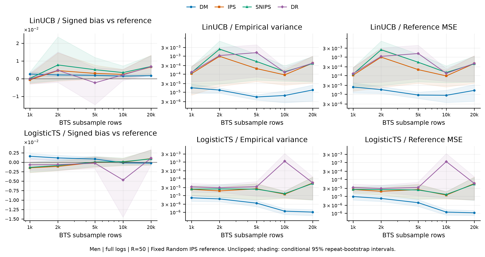
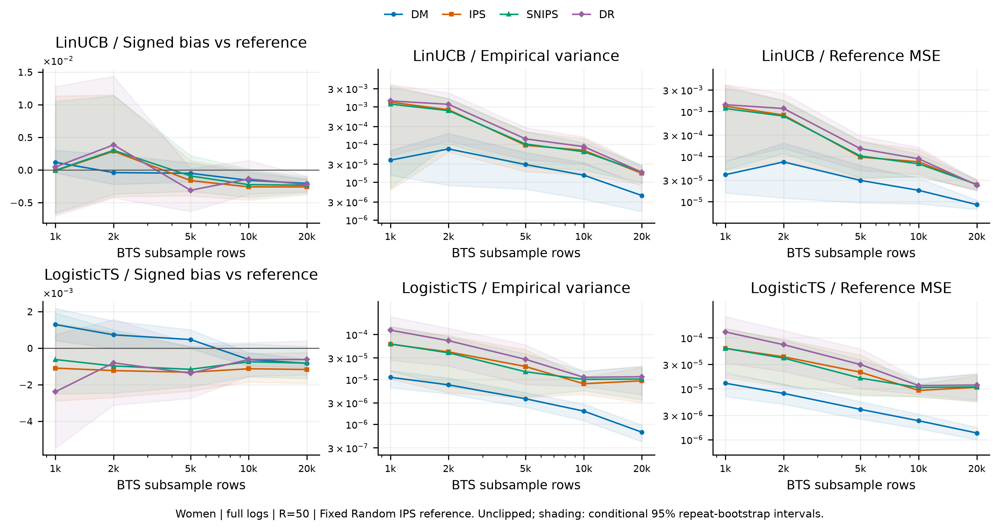
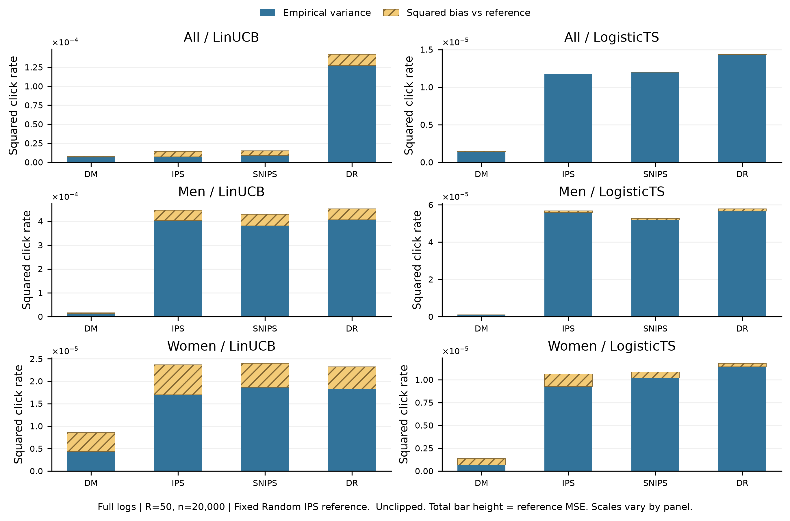
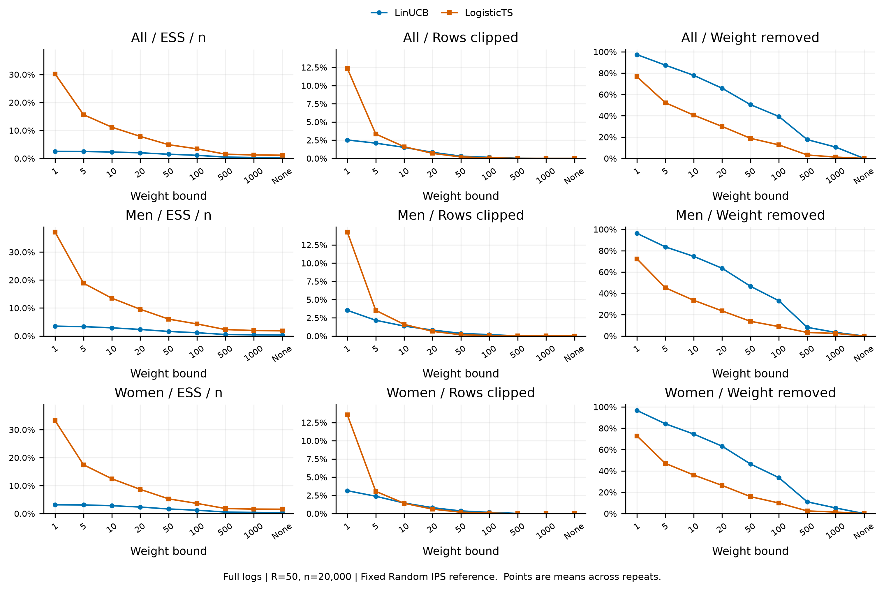
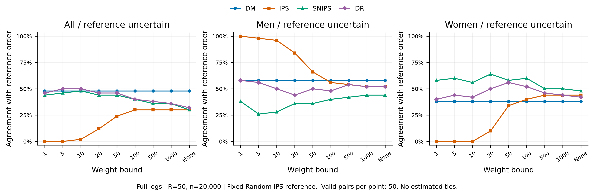

# 成员 E 实验分析与交付报告

本报告来自运行 16435ab2e024fdcd，Git 基准为 d5cf726d388cf170f9b340601b1cb0f4e0281215。使用 50 次重复，样本量为 [1000, 2000, 5000, 10000, 20000]。目标策略由 Random/train 冻结训练，每个 BTS 子样本重新进行 3 折交叉拟合，全部策略和截断规则共享预测。

## 统计定义

对每条已展示动作与推荐位，权重为 w=πe(a|x,position)/pscore，截断后为 min(w,c)。IPS 使用截断权重乘点击奖励，SNIPS 再以权重总和归一化，DR 使用目标分布下的奖励预测加截断加权残差。无截断规则使用原始权重，DM 对全部阈值保持相同。

相对固定参考值 g，经验偏差为 mean(V̂)−g，经验方差为 mean((V̂−mean(V̂))²)，参考 MSE 为 mean((V̂−g)²)。三者满足 MSE=bias²+variance。图表使用原始奖励单位和对应平方单位，结果保留负 DR 估计及无定义 SNIPS 状态。

## 参考值与窗口

Random 日志 IPS 估计作为固定参考。表中区间为按 Random 行重采样的 95% bootstrap 区间。共同测试时间窗口减少时间段差异，用户上下文及推荐位分布仍可能影响跨日志可比性。

| Campaign | 策略 | 参考 CTR | 95% 区间 | ESS | 非零贡献数 |
|---|---|---|---|---|---|
| all | linucb | 0.562765% | [0.368708%, 0.776228%] | 5068 | 29 |
| all | logisticts | 0.467859% | [0.399295%, 0.543989%] | 30020 | 460 |
| men | linucb | 0.400412% | [0.225232%, 0.600618%] | 4158 | 16 |
| men | logisticts | 0.548221% | [0.452390%, 0.639770%] | 19487 | 352 |
| women | linucb | 0.748898% | [0.534927%, 0.945484%] | 5633 | 42 |
| women | logisticts | 0.617395% | [0.517897%, 0.726352%] | 21998 | 488 |

all 使用 intersection 窗口，random 共 412,250 行，从 2019-11-28T17:04:50.826684+00:00 到 2019-11-30T23:59:59.408889+00:00，bts 共 3,699,592 行，从 2019-11-28T17:04:51.401911+00:00 到 2019-11-30T23:59:59.160792+00:00。

men 使用 intersection 窗口，random 共 135,860 行，从 2019-11-28T15:49:53.338691+00:00 到 2019-11-30T23:59:58.340081+00:00，bts 共 1,216,634 行，从 2019-11-28T15:49:54.621986+00:00 到 2019-11-30T23:59:57.891542+00:00。

women 使用 intersection 窗口，random 共 257,979 行，从 2019-11-28T15:23:48.676837+00:00 到 2019-11-30T23:59:57.920185+00:00，bts 共 2,329,175 行，从 2019-11-28T15:23:48.035014+00:00 到 2019-11-30T23:59:57.581626+00:00。

## 固定上限截断

下表使用每组最大样本量 20,000，列出 DR 在固定网格中的最低参考 MSE。配对差为该规则的逐次平方误差减去无截断平方误差，区间在共同有效 repeat 上重采样。

| Campaign | 策略 | 观察最低点 | 无截断 MSE | 网格最低 MSE | 配对 MSE 差及 95% 区间 |
|---|---|---|---|---|---|
| all | linucb | cap_1 | 0.00014193 | 7.6293e-06 | -0.0001343 [-0.00036845, -4.8698e-06] |
| all | logisticts | cap_1 | 1.4367e-05 | 1.4606e-06 | -1.2906e-05 [-2.2209e-05, -5.298e-06] |
| men | linucb | cap_1 | 0.00045283 | 1.627e-05 | -0.00043656 [-0.0011262, -2.7084e-05] |
| men | logisticts | cap_1 | 5.7876e-05 | 1.0397e-06 | -5.6836e-05 [-0.00014233, -5.1353e-06] |
| women | linucb | cap_10 | 2.32e-05 | 8.043e-06 | -1.5157e-05 [-2.2445e-05, -9.6214e-06] |
| women | logisticts | cap_1 | 1.1806e-05 | 1.3904e-06 | -1.0416e-05 [-1.8946e-05, -4.7289e-06] |

这些最低点由同一网格的结果选出，后续泛化效果需要独立数据评估。对每个阈值的原始结果、MC 标准误及有效次数均保存在 summary.csv。

## 无截断估计器比较

以下数据均采用 n=20,000。相对参考值的经验偏差保留正负号。

| Campaign | 策略 | 估计器 | Bias(ref) | 经验方差 | 参考 MSE | 有效重复数 |
|---|---|---|---|---|---|---|
| all | linucb | DM | -0.00093797 | 6.7459e-06 | 7.6257e-06 | 50/50 |
| all | linucb | DR | -0.0038248 | 0.00012731 | 0.00014193 | 50/50 |
| all | linucb | IPS | -0.0026572 | 7.2173e-06 | 1.4278e-05 | 50/50 |
| all | linucb | SNIPS | -0.0024641 | 8.9172e-06 | 1.4989e-05 | 50/50 |
| all | logisticts | DM | -0.00025907 | 1.3873e-06 | 1.4545e-06 | 50/50 |
| all | logisticts | DR | 0.00011163 | 1.4354e-05 | 1.4367e-05 | 50/50 |
| all | logisticts | IPS | -1.5355e-06 | 1.1769e-05 | 1.1769e-05 | 50/50 |
| all | logisticts | SNIPS | 7.2856e-05 | 1.1987e-05 | 1.1992e-05 | 50/50 |
| men | linucb | DM | 0.001706 | 1.3175e-05 | 1.6085e-05 | 50/50 |
| men | linucb | DR | 0.0067966 | 0.00040663 | 0.00045283 | 50/50 |
| men | linucb | IPS | 0.00661 | 0.00040371 | 0.0004474 | 50/50 |
| men | linucb | SNIPS | 0.0069267 | 0.00038143 | 0.00042941 | 50/50 |
| men | logisticts | DM | -0.00022573 | 1.0164e-06 | 1.0674e-06 | 50/50 |
| men | logisticts | DR | 0.0010811 | 5.6707e-05 | 5.7876e-05 | 50/50 |
| men | logisticts | IPS | 0.00098046 | 5.5836e-05 | 5.6797e-05 | 50/50 |
| men | logisticts | SNIPS | 0.00089615 | 5.1908e-05 | 5.2711e-05 | 50/50 |
| women | linucb | DM | -0.0020374 | 4.4068e-06 | 8.5578e-06 | 50/50 |
| women | linucb | DR | -0.0022163 | 1.8288e-05 | 2.32e-05 | 50/50 |
| women | linucb | IPS | -0.0025789 | 1.7012e-05 | 2.3663e-05 | 50/50 |
| women | linucb | SNIPS | -0.0023179 | 1.864e-05 | 2.4013e-05 | 50/50 |
| women | logisticts | DM | -0.00082653 | 6.6655e-07 | 1.3497e-06 | 50/50 |
| women | logisticts | DR | -0.00061836 | 1.1424e-05 | 1.1806e-05 | 50/50 |
| women | logisticts | IPS | -0.0011623 | 9.283e-06 | 1.0634e-05 | 50/50 |
| women | logisticts | SNIPS | -0.00081359 | 1.0173e-05 | 1.0835e-05 | 50/50 |

all/linucb 的固定网格最低 DR 参考 MSE 与同组 DM 参考 MSE 的比值为 1。

all/logisticts 的固定网格最低 DR 参考 MSE 与同组 DM 参考 MSE 的比值为 1.004。

men/linucb 的固定网格最低 DR 参考 MSE 与同组 DM 参考 MSE 的比值为 1.012。

men/logisticts 的固定网格最低 DR 参考 MSE 与同组 DM 参考 MSE 的比值为 0.9741。

women/linucb 的固定网格最低 DR 参考 MSE 与同组 DM 参考 MSE 的比值为 0.9398。

women/logisticts 的固定网格最低 DR 参考 MSE 与同组 DM 参考 MSE 的比值为 1.03。

强截断削弱 DR 残差校正项，使其更多依赖奖励模型。在参考 MSE 比值接近 1 的设置中，分解曲线与权重诊断有助于区分模型项和高波动校正项的贡献。该解释以当前冻结策略、参考值和奖励模型为条件。

## 权重与覆盖

下表以各组固定网格最低 DR 参考 MSE 对应的规则为诊断对象，ESS/n、截断行比例和移除权重比例取重复均值。最大原始权重取这些重复中观测到的最大值。

| Campaign | 策略 | 规则 | 原始 ESS/n | 截断 ESS/n | 截断行比例 | 移除权重比例 | 最大原始权重 |
|---|---|---|---|---|---|---|---|
| all | linucb | cap_1 | 0.228% | 2.530% | 2.530% | 97.320% | 20000 |
| all | logisticts | cap_1 | 1.145% | 30.195% | 12.342% | 76.579% | 4140.6 |
| men | linucb | cap_1 | 0.353% | 3.519% | 3.519% | 96.231% | 5405.4 |
| men | logisticts | cap_1 | 1.850% | 37.114% | 14.246% | 72.304% | 15625 |
| women | linucb | cap_10 | 0.317% | 2.813% | 1.448% | 74.565% | 3703.7 |
| women | logisticts | cap_1 | 1.555% | 33.207% | 13.545% | 72.777% | 31250 |

## 样本量、分位数与排序

| Campaign | 策略 | 最小 n 无截断 DR MSE | 最大 n 无截断 DR MSE | 最大 n 最低分位数规则 |
|---|---|---|---|---|
| all | linucb | 5.6599e-05 | 0.00014193 | qpos_0.9, MSE=1.0978e-05 |
| all | logisticts | 0.0037386 | 1.4367e-05 | qpos_0.9, MSE=1.6529e-06 |
| men | linucb | 0.00012806 | 0.00045283 | qpos_0.9, MSE=2.6741e-05 |
| men | logisticts | 3.2803e-05 | 5.7876e-05 | qpos_0.9, MSE=1.0696e-06 |
| women | linucb | 0.0014119 | 2.32e-05 | qpos_0.9, MSE=9.5254e-06 |
| women | logisticts | 0.00012935 | 1.1806e-05 | qpos_0.9, MSE=1.5606e-06 |

all/linucb 的无截断 DR 参考 MSE 从 n=1,000 到 n=20,000 上升或持平，最大样本量下经验方差占其参考 MSE 的 89.7%。

all/logisticts 的无截断 DR 参考 MSE 从 n=1,000 到 n=20,000 下降，最大样本量下经验方差占其参考 MSE 的 99.9%。

men/linucb 的无截断 DR 参考 MSE 从 n=1,000 到 n=20,000 上升或持平，最大样本量下经验方差占其参考 MSE 的 89.8%。

men/logisticts 的无截断 DR 参考 MSE 从 n=1,000 到 n=20,000 上升或持平，最大样本量下经验方差占其参考 MSE 的 98.0%。

women/linucb 的无截断 DR 参考 MSE 从 n=1,000 到 n=20,000 下降，最大样本量下经验方差占其参考 MSE 的 78.8%。

women/logisticts 的无截断 DR 参考 MSE 从 n=1,000 到 n=20,000 下降，最大样本量下经验方差占其参考 MSE 的 96.8%。

各样本量分别抽样并重新拟合。罕见的大权重可能使少量重复主导平均平方误差，应结合逐次误差和 Monte Carlo 区间解释样本量曲线。

all 的参考差为 0.00094906，配对 95% 区间为 [-0.000579442, 0.00248082]，参考排序状态为 uncertain。无截断的经验排序一致率为 DM 48.0%，DR 32.0%，IPS 30.0%，SNIPS 30.0%。

men 的参考差为 -0.00147808，配对 95% 区间为 [-0.00303447, 2.01379e-05]，参考排序状态为 uncertain。无截断的经验排序一致率为 DM 58.0%，DR 52.0%，IPS 52.0%，SNIPS 44.0%。

women 的参考差为 0.00131503，配对 95% 区间为 [-0.000340111, 0.00298396]，参考排序状态为 uncertain。无截断的经验排序一致率为 DM 38.0%，DR 42.0%，IPS 44.0%，SNIPS 48.0%。

## 统计口径与验收

- 84,000 条逐次估计，1,680 条汇总，840 条排序汇总。
- 偏差平方加经验方差与参考 MSE 的最大残差为 1.73e-18，经验方差使用分母 R。
- 奖励模型拟合时间合计 199.3 秒。捕获的拟合告警总数为 0，详情见 diagnostics.csv。
- 无定义估计共 0 条，负估计共 1043 条。
- 区间条件于固定日志、固定参考值和相应有效估计集合，Monte Carlo 不确定性与参考抽样误差分别保存。
- ESS 用于诊断权重集中程度。稀疏点击、低覆盖、上下文差异和记录依赖性共同限制结论范围。
- 两目标策略严格排序时 Spearman 取 +1 或 -1，报告同时提供并列率及有效配对次数。

## 图表资产

同一张图中的颜色和标记见顶部图例。阴影为固定参考值下对重复抽样计算的 95% 区间。

**固定上限如何改变四种估计器的参考 MSE**　[矢量 PDF](../results/figures/e_full/clipping_mse_by_campaign.pdf)

**All 的样本量与有符号偏差、方差、参考 MSE**　[矢量 PDF](../results/figures/e_full/sample_size_all.pdf)

**Men 的样本量与有符号偏差、方差、参考 MSE**　[矢量 PDF](../results/figures/e_full/sample_size_men.pdf)

**Women 的样本量与有符号偏差、方差、参考 MSE**　[矢量 PDF](../results/figures/e_full/sample_size_women.pdf)

**无截断时的方差柱状图，柱顶为方差与偏差平方之和**　[矢量 PDF](../results/figures/e_full/variance_decomposition_by_campaign.pdf)

**有效样本量比例、截断行比例与移除的权重**　[矢量 PDF](../results/figures/e_full/weight_diagnostics_by_campaign.pdf)

**各估计器与经验参考排序的一致率**　[矢量 PDF](../results/figures/e_full/ranking_agreement_by_campaign.pdf)

逐阈值的偏差平方与方差、正权重分位数的 MSE 也可从同一份 CSV 单独出图。在绘图命令后添加 `--details-dir tmp/e_figure_details` 即可。

## 复现与交接

逐次结果和汇总表位于 results/sensitivity/e_full。manifest.json 记录输入、源码、环境及 CSV 的 SHA-256。图表为 300 DPI PNG 与矢量 PDF，见 results/figures/e_full。海报表格由 generated_results.tex 读取，同源数值的追溯信息在 poster/results_provenance.json。

使用已保存的结果重新出图，可直接在项目根目录运行以下命令。完整实验的重跑方法见 README 的成员 E 小节。

~~~powershell
uv sync --locked
uv run python -m scripts.plot_sensitivity --run-dir "results/sensitivity/e_full" --out-dir "results/figures/e_full"
~~~

方法背景见 OBD/OBP 原始论文和截断、收缩的 OPE 研究。 [Saito 等](https://arxiv.org/abs/2008.07146)，[Su 等](https://proceedings.mlr.press/v119/su20a.html)。

## 本次交付验证记录

<!-- run-manifest-sha256: 2cbd36170ff189b48196fdc3078f32488cf8a31e34fd013baac07ca764b38b1f -->

### 2026-11-18 完整性与数值复核

成员 E 在本地已完成提案第 3 页约定的截断实验、样本量与偏差—方差分析、Matplotlib 图表及 A4 答辩海报。本次复核以冻结策略和处理后的日志为起点，逐一核对三个 campaign 的时间窗口、57 项输入文件摘要、计算源码摘要和正式运行的五张 CSV。[提案](../openbanditproposal.pdf)　[运行清单](../results/sensitivity/e_full/manifest.json)

| 复核对象 | 做法与结果 |
|---|---|
| 六个策略参考值 | 从共同窗口的 Random/test 行，按实际展示的动作和位置重算 IPS、标准误和行 bootstrap 区间。六个参考值及三个策略收益差的配对区间均与记录一致。 |
| 84,000 条估计 | 按原种子重取 3 个 campaign × 5 档样本量 × 50 次重复，共 750 个 BTS 子样本。使用项目的三折奖励模型重新拟合，另按定义计算两种策略、14 种规则下的 DM、IPS、SNIPS 和 DR。最大绝对差为 1.11 × 10⁻¹⁶，拟合告警为零。 |
| 统计汇总与排序 | 从逐次估计重新计算 1,680 组偏差、经验方差、MSE、配对差及其 bootstrap 区间，核对 840 组排序一致率、并列率与 Spearman 均值。全部匹配。MSE 与偏差平方加方差的最大残差为 1.73 × 10⁻¹⁸。 |
| 图表、海报与测试 | 正式目录收录 7 张图，每张均有 300 DPI PNG 和矢量 PDF。七张图及两张海报内嵌图共用图外顶部图例，导出时图例与最近面板内容的间距为 5 磅。最终海报已编译、渲染，确认为单页 A4 横向。41 项测试通过，2 项与可选 OBP 库的对照因该库未安装而跳过。 |

海报中 94.6% 和 89.8% 是 **All campaign、n=20,000、截断上限为 1 时 DR 相对未截断 DR 的参考 MSE 降幅**，依次对应 LinUCB 和 LogisticTS。All/LinUCB 未截断时，50 次重复中误差最大的一次占总平方误差的 79.4%。Women/LinUCB 的观测最低点在上限 10。阈值来自同一批样本上的比较，其他日志上的表现仍需独立验证。[逐次估计](../results/sensitivity/e_full/replicates.csv)　[汇总表](../results/sensitivity/e_full/summary.csv)

三个 campaign 的两策略参考收益差的配对 95% 区间都跨过零，排序图衡量的是与经验参考顺序的一致率。参考区间按曝光行重采样，同一用户或会话内的相关性可能影响区间覆盖率。[参考值](../results/sensitivity/e_full/references.csv)　[排序统计](../results/sensitivity/e_full/ranking.csv)

本次审核覆盖成员 E 的实验、图表、分析报告和 A4 海报。全组最终报告、Slides、Zoom 录屏和 Canvas 提交状态需另行确认。[课程要求](../final_project_des.pdf)

### 2026-11-17 首次运行记录

2026-11-17 完成首次正式运行，当时导出 18 组图表，37 项测试通过，2 项可选 OBP 对照跳过。测试涉及截断手算、参考值、时间窗口、随机种子、零权重、排序、运行恢复与结果校验。11 月 18 日复核后，正式目录收录 7 组图表。[图表清单](../results/figures/e_full/manifest.json)

已在锁定环境完成官方样例与全量来源日志的标准入口运行。官方 ZIP 的 SHA-256 为 e8ec18196582a5937381a1776382ca940689b90a18d2dcd1fb635be6df614d78，与历史交接记录一致。全量数据构建的样本数、点击数、清洗删除数和特征维度与 B 的已提交记录一致。当前机器为 16 GB 内存，数据读取改为紧凑 Arrow 类型，清洗过程减少整表复制，并验证清洗函数保持调用方输入。

正式实验使用方案的共同时间窗口、三折重拟合、50 次重复、五档样本量、八个固定上限、一组无截断对照及五个正权重分位数规则。计时实验选择规模最大的 All campaign，n=2,000 与 20,000，各三次重复，奖励模型平均拟合耗时分别约为 0.10 秒和 1.00 秒。C 的训练与 E 的运行使用单线程 BLAS，完整运行的依赖版本见 manifest.json。

海报主图选用数据规模最大的 All campaign，截断对照采用最大样本量 20,000。

参考排序区间在三个 campaign 均跨过零。策略收益优劣的解释受参考抽样误差约束。当前参考清单对齐依据包含 C 的行键摘要与特征名，本次输入文件额外保存 SHA-256 和清单快照，用于重跑身份核验。

交付后已清理样例与计时产物、完成运行的检查点及原始 CSV 解压副本，保留官方 ZIP、处理后数据和全量策略。当前正式结果可直接用于绘图；重新执行实验会按固定种子重建检查点，数据准备入口可从 ZIP 重新解压。
